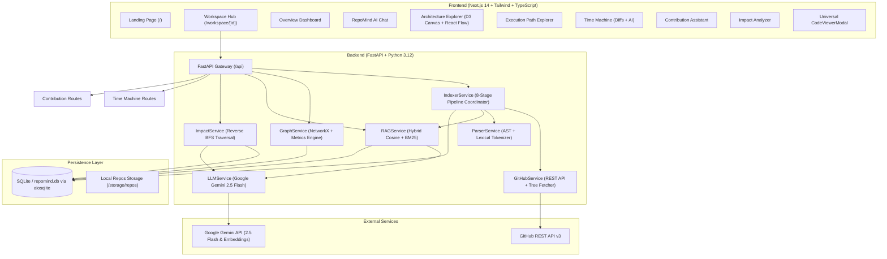
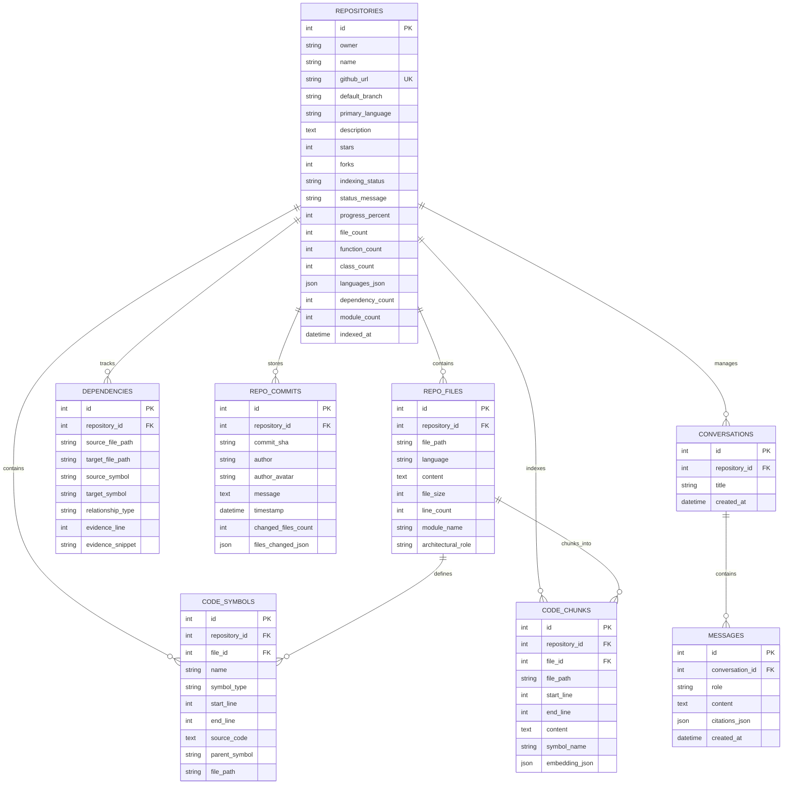

# Product Requirements Document (PRD): RepoMind

**Project Name:** RepoMind  
**Tagline:** *"Understand any codebase. Navigate any complexity."*  
**Document Version:** 1.0.0  
**Current Status:** Functional Beta / Prototype with Live Multi-Module Architecture  
**Primary Language / Stack:** Next.js 14+ (App Router), TypeScript, FastAPI (Python 3.10+), SQLAlchemy (Async), Google Gemini 2.5 Flash, NetworkX, D3.js, React Flow  
**Target Audience:** Software Engineers, Technical Leads, Open Source Maintainers, and Autonomous AI Coding Agents  

---

## 1. Executive Summary & Product Vision

### 1.1 The Problem
Understanding large, unfamiliar, or legacy codebases is one of the most time-consuming engineering challenges:
1. **High Cognitive Onboarding Barrier**: New contributors or engineers take days or weeks to grasp architecture, control flows, and module dependencies.
2. **Architectural Opacity**: Static documentation is frequently obsolete. Code mental models are difficult to visualize without interactive dependency maps.
3. **Hallucination in AI Assistants**: Generic AI assistants without strict codebase grounding invent nonexistent APIs, make up file paths, and fail to provide exact line-level evidence.
4. **Fear of Regressions**: Developers hesitate to refactor core modules because they cannot reliably predict the "blast radius" of their changes across transitive callers.
5. **Open Source Contribution Friction**: Junior and intermediate developers struggle to translate high-level GitHub issues into actionable code modifications.

### 1.2 The Solution
**RepoMind** is an AI-powered codebase intelligence and open-source contribution platform. It ingests public (and planned private) GitHub repositories, parses syntax and semantic structures into an interactive multi-layer knowledge graph, indexes code chunks into vector and lexical search spaces, and provides six interconnected developer intelligence modules:
1. **RepoMind Grounded AI**: Evidence-backed natural language Q&A with exact line-range citations `[file:start-end]` and zero-hallucination guardrails.
2. **Architecture Explorer**: A dual-view visual workspace featuring an Obsidian-style cosmos graph (D3 force-directed physics canvas) and a hierarchical system DAG (React Flow).
3. **Execution Path Explorer**: Static caller-callee invocation chaining across functions and methods.
4. **Codebase Time Machine**: Commit history inspector with live diff patch view and one-click AI architectural change explanations.
5. **Contribution Assistant**: Live GitHub issue ingestion, beginner-to-senior persona toggling, and automated step-by-step contribution roadmaps.
6. **Impact Analyzer**: Dependency blast radius calculator that traversals reverse call graphs to classify proposed changes into High, Medium, and Low impact tiers.

---

## 2. System Architecture & Component Topology



---

## 3. Technology Stack & Environment

| Component | Technology | Version / Spec | Purpose |
| :--- | :--- | :--- | :--- |
| **Frontend Framework** | Next.js | 14+ (App Router) | Reactive UI, Server/Client components, SSR layouts |
| **Language (Web)** | TypeScript | 5.0+ | Strict type contracts across client code and API responses |
| **Styling** | Tailwind CSS | 3.4+ | Cyberpunk / dark IDE theme (`#090d16` background palette) |
| **Icons** | Lucide React | Latest | Semantic developer interface iconography |
| **Graph Visualization** | D3-Force Canvas | 7.x | High-performance 60fps force-directed physics graph |
| **DAG Visualization** | `@xyflow/react` | 12.x | Hierarchical layered architecture layout |
| **Backend Framework** | FastAPI | 0.110+ | Asynchronous REST API with auto OpenAPI Swagger documentation |
| **ASGI Server** | Uvicorn | Latest | High-throughput asynchronous server |
| **Language (Core)** | Python | 3.10+ / 3.12+ | AST parsing, graph algorithms, and AI pipeline orchestration |
| **ORM & Async DB** | SQLAlchemy + aiosqlite | 2.0+ (Async) | Async relational querying and database migration baseline |
| **Graph Modeling** | NetworkX | 3.2+ | DiGraph construction, degree centrality, BFS blast radius |
| **AI LLM** | Google Gemini 2.5 Flash | `gemini-2.5-flash` | High-speed grounded reasoning, roadmaps, and commit explanations |
| **Code Embeddings** | Gemini Embedding 001 | `models/gemini-embedding-001` | 768-dimensional semantic code vector representations |
| **Database** | SQLite3 | Local `repomind.db` | Portable zero-config storage (PostgreSQL/pgvector ready) |

---

## 4. Database Schema & Data Models

The persistence layer is modeled with SQLAlchemy async ORM inside `backend/app/models/schema.py`:



---

## 5. Detailed Feature Specifications & Current Status

### 5.1 Pipeline 0: 8-Stage Real-Time Ingestion & Indexing Engine
- **Purpose**: Connect a repository URL, download source assets, parse symbols and relationships, and index semantic embeddings.
- **Current Pipeline Stages**:
  1. `10%` Connecting to GitHub API & validating repository visibility/metadata.
  2. `20%` Retrieving recursive repository git tree hierarchy via `GET /repos/{owner}/{repo}/git/trees/{branch}?recursive=1`.
  3. `35%` Language identification, blacklist filtering (stripping `node_modules`, `.git`, `.venv`, binaries, lock files), and downloading content in concurrent batches of 10.
  4. `55%` Multi-language AST parsing (native Python `ast` + lexical regex tokenizer for JS/TS/Go/Rust/Java/etc.).
  5. `65%` Symbol extraction: functions, methods, classes, interfaces, entry points.
  6. `70%` Cross-file dependency and call graph construction (imports, class inheritance, function calls).
  7. `85%` Search chunk generation (symbol boundary + sliding window) and vector embedding generation via Gemini API.
  8. `100%` Commit history retrieval (latest 20-30 commits) and final database record completion.
- **Current Constraints**:
  - `MAX_FILES_PER_REPO`: 1,500 files to avoid rate limiting.
  - `MAX_FILE_SIZE_BYTES`: 500 KB per file.
  - Ingestion currently uses file-by-file REST calls rather than a compressed git tarball.

---

### 5.2 Module 1: RepoMind Grounded AI (`/workspace/[id]/chat`)
- **Purpose**: Natural-language conversational code intelligence with zero hallucination.
- **Workflow**:
  1. User enters natural language prompt (e.g., *"How does route registration work in Express?"*).
  2. RAG engine conducts hybrid retrieval:
     - Vector cosine similarity on Gemini embeddings (`CodeChunk.embedding_json`).
     - Token-level BM25 keyword matching for exact identifier hits (functions, classes, file names).
  3. Top 6 relevant code snippets are injected into Gemini 2.5 Flash context under strict delimited system instructions.
  4. Prompt mandates that the AI cite exact line ranges using `[file_path:start-end]` format.
  5. If evidence is lacking, the model explicitly acknowledges insufficient context.
  6. Frontend parses citation tags into interactive clickable badges that open the file in the code viewer at the exact line offset.

---

### 5.3 Module 2: Architecture Explorer (`/workspace/[id]/architecture`)
- **Purpose**: Comprehensive visual exploration of the repository's topology and architectural tiers.
- **Views Implemented**:
  1. **Obsidian Cosmos Graph**:
     - Physics-based force-directed canvas rendered in D3.
     - **Directory Hubs**: Large violet orbital nodes grouping file children.
     - **File Nodes**: Sized by connectivity (in-degree + out-degree) and colored by language.
     - **Satellite Symbols**: Orbiting function and class dots.
     - **Focus Dimming**: Hovering over any node highlights adjacent edges and smoothly dims unrelated nodes.
  2. **Hierarchical Architecture Flow**:
     - React Flow DAG organizing files across system layers (Entry Point → Route/Controller → Service → Model/Entity → Data Repository → Utility).
  3. **Backend Multi-View Engine (`GraphService`)**:
     - `get_project_structure`: Physical folder/containment tree (zero import edges).
     - `get_dependency_map`: True architectural dependency graph with relationship types (`imports`, `calls`, `inherits`, `data_access`).
     - `get_feature_flow`: Workflow execution pipelines across system layers for preset scenarios (e.g., "Request Routing & Handling", "Middleware Pipeline").
     - `get_edge_details`: Returns the exact line number and code snippet justifying why an edge exists.
  4. **Node Details Drawer**:
     - Displays line count, file size, architectural role, detected symbols, incoming/outgoing dependencies, and syntax-highlighted code preview.

---

### 5.4 Module 3: Execution Path Explorer (`/workspace/[id]/execution-path`)
- **Purpose**: Static call-chain tracing showing upstream callers and downstream callees for any chosen function or method.
- **UI State**:
  - Searchable autocomplete list of all detected functions and methods.
  - Sequential call-chain visualization: `[Callers Layer] → [Target Function] → [Callee Layer] → [Downstream Services]`.
  - Transparent static analysis notice indicating that paths represent static symbol invocations rather than dynamic runtime traces.
- **CURRENT STATUS & CRITICAL GAP**:
  - **Identified Defect**: In `backend/app/api/routes_execution_path.py`, the endpoint calls `graph_service.get_execution_path(db, repo_id, symbol)`. However, `GraphService` in `backend/app/services/graph_service.py` is currently missing the `get_execution_path` implementation!
  - **Resolution**: Implementation required (provided in Section 8).

---

### 5.5 Module 4: Codebase Time Machine (`/workspace/[id]/time-machine`)
- **Purpose**: Inspect repository commit history, analyze git diffs, and generate AI architectural summaries of changes.
- **Features**:
  - Real-time commit timeline with author avatars, commit SHAs, timestamps, and commit messages.
  - Live GitHub commit diff inspector showing file additions, deletions, and unified patch diff lines (`+`, `-`).
  - **AI Explain Commit**: One-click Gemini analysis summarizing:
    1. Core Purpose (1-2 sentence overview).
    2. Key Modifications (bulleted architectural updates).
    3. Potential Regressions & Breaking Risks.

---

### 5.6 Module 5: Contribution Assistant (`/workspace/[id]/contribution`)
- **Purpose**: Bridge the gap between open GitHub issues and actionable code changes for contributors.
- **Features**:
  - Live fetch of open issues directly from GitHub.
  - Custom issue or feature inquiry mode.
  - **Beginner-Friendly Mode Toggle**: Adjusts language, technical complexity, and prerequisite guidance.
  - **AI Contribution Roadmap**:
    - High-level issue summary.
    - Hypothesized technical problem cause.
    - Target files to modify (with explicit architectural reasoning).
    - Step-by-step investigation procedures.
    - Concrete implementation plan.
    - Comprehensive testing & validation checklist.
    - Potential regression risks.

---

### 5.7 Module 6: Impact Analyzer (`/workspace/[id]/impact`)
- **Purpose**: Statically calculate the ripple effects and blast radius of a proposed refactoring or bug fix before writing code.
- **Algorithm**:
  1. Seed identification: Matches proposed change query words against file paths and symbol names.
  2. Reverse dependency traversal (NetworkX): Traverses incoming import edges in reverse (`target_file -> source_file`).
  3. Classification tiers:
     - **HIGH IMPACT**: Direct target seed files and direct 1st-degree callers/importers.
     - **MEDIUM IMPACT**: Transitive 2nd-degree dependent callers.
     - **LOW IMPACT**: Peripheral documentation, test suites, or configuration files.
  4. AI Risk Assessment: Gemini evaluates breaking changes, edge cases, and provides a customized test verification plan.

---

## 6. API Endpoint Catalog

All routes are prefixed with `/api` and defined in `backend/app/api/`:

| Method | Endpoint | Request Payload | Response Summary |
| :--- | :--- | :--- | :--- |
| `POST` | `/repos/connect` | `{"url": string}` | Triggers async 8-stage indexing; returns `repo_id` |
| `GET` | `/repos` | None | Returns list of all connected repositories |
| `GET` | `/repos/{id}` | None | Returns repository metadata, status, and stats |
| `GET` | `/repos/{id}/files` | None | Returns list of source files |
| `GET` | `/repos/{id}/file-content` | `?path=string` | Returns raw code content, line count, and symbols |
| `POST` | `/chat/query` | `{"repository_id": int, "query": string, "conversation_id"?: int}` | RAG answer, exact citations, and retrieved sources |
| `GET` | `/chat/conversations/{repo_id}` | None | Returns previous chat sessions |
| `GET` | `/chat/history/{conv_id}` | None | Returns conversation message history |
| `GET` | `/architecture/obsidian/{repo_id}` | None | Returns nodes (dirs/files) and links for D3 canvas |
| `GET` | `/architecture/flow/{repo_id}` | None | Returns React Flow nodes and edges |
| `GET` | `/architecture/project-structure/{id}`| None | Physical directory/file containment hierarchy |
| `GET` | `/architecture/dependency-map/{id}` | `?level=files&selected_module=str` | Structured dependency graph with metrics |
| `POST` | `/architecture/feature-flow` | `{"repo_id": int, "workflow_query"?: str}` | Cross-layer execution pipeline for workflows |
| `GET` | `/architecture/edge-details/{id}` | `?source=str&target=str&rel_type=str` | Evidence line number and code snippet for edge |
| `GET` | `/architecture/node-details/{id}` | `?path=str` | Metadata, symbols, in/out dependencies for file |
| `GET` | `/execution-path/symbols/{id}` | None | Top 100 functions/methods for autocomplete |
| `GET` | `/execution-path/trace/{id}` | `?symbol=str` | Traces callers, target, and callees (*Needs Fix*) |
| `GET` | `/time-machine/commits/{id}` | None | List of stored commits |
| `GET` | `/time-machine/details/{id}` | `?sha=str` | Patch diffs, additions, deletions from GitHub |
| `POST` | `/time-machine/explain` | `{"repo_id": int, "commit_sha": str, "diff_summary": str, "message": str}` | AI breakdown of commit impact |
| `GET` | `/contribution/issues/{id}` | None | Fetches open GitHub issues |
| `POST` | `/contribution/roadmap` | `{"repo_id": int, "issue_number": int, "issue_title": str, "issue_body"?: str, "beginner_mode": bool}` | Actionable roadmap JSON |
| `POST` | `/impact/analyze` | `{"repo_id": int, "proposed_change": str}` | Blast radius breakdown and risk assessment |

---

## 7. Current Technical Gaps & Technical Debt

### Gap 1: Missing `get_execution_path` in `GraphService`
- **Location**: `backend/app/services/graph_service.py`
- **Symptom**: Calling `GET /api/execution-path/trace/{repo_id}?symbol={name}` crashes with `AttributeError: 'GraphService' object has no attribute 'get_execution_path'`.
- **Priority**: **P0 (Immediate Fix)**.

### Gap 2: In-Memory Vector Search Over Capped Embeddings
- **Location**: `backend/app/services/indexer_service.py` & `rag_service.py`
- **Symptom**: Only the top 40 code chunks receive vector embeddings to keep ingestion fast. Vectors are stored in SQLite as JSON arrays (`embedding_json`) and scanned in-memory via NumPy. This will degrade on repositories with >100 files.
- **Priority**: **P1 (High)**.

### Gap 3: File-by-File GitHub API Ingestion Bottleneck
- **Location**: `backend/app/services/indexer_service.py`
- **Symptom**: Ingestion performs batched HTTP calls for each candidate file. For a 300-file repository, this takes ~30 HTTP round trips, slowing down indexing and consuming GitHub API quotas.
- **Priority**: **P1 (High)**.

### Gap 4: Non-Streaming AI Responses (High TTFB)
- **Location**: `backend/app/api/routes_chat.py` & `llm_service.py`
- **Symptom**: Chat queries wait for the full Gemini response to finish generating before returning JSON, resulting in a 3-6 second loading delay.
- **Priority**: **P2 (Medium)**.

### Gap 5: Regex-Based Parsing for Non-Python Languages
- **Location**: `backend/app/services/parser_service.py`
- **Symptom**: Non-Python languages (TS, JS, Go, Rust) are parsed via regex. Complex destructuring, aliasing, or re-exports may miss some symbols or dependencies.
- **Priority**: **P2 (Medium)**.

---

## 8. Strategic Advices & Actionable Roadmap for Collaborating AI / Engineers

This section provides clear, prioritized engineering instructions for a collaborating developer or AI coding partner to implement immediately.

### Phase 1: Immediate Bug Fixes & Code Hardening (Sprint 1)

#### 1. Implement `get_execution_path` in `GraphService`
Add the following method to `backend/app/services/graph_service.py`:
```python
async def get_execution_path(self, session: AsyncSession, repo_id: int, symbol_name: str) -> Dict[str, Any]:
    """
    Traces upstream callers and downstream callees for a specified function/method.
    Returns: target_symbol, callers, callees, flow_chain, static_analysis_notice.
    """
    sym_stmt = select(CodeSymbol).where(
        CodeSymbol.repository_id == repo_id,
        func.lower(CodeSymbol.name) == symbol_name.lower()
    )
    res = await session.execute(sym_stmt)
    target = res.scalars().first()
    if not target:
        return {"error": f"Symbol '{symbol_name}' not found in indexed codebase."}

    # Fetch file for target
    file_res = await session.execute(select(RepoFile).where(RepoFile.id == target.file_id))
    target_file = file_res.scalar_one_or_none()

    # Find incoming callers (dependencies where target_symbol == target.name)
    callers_stmt = select(Dependency).where(
        Dependency.repository_id == repo_id,
        func.lower(Dependency.target_symbol) == symbol_name.lower(),
        Dependency.relationship_type.in_(["calls", "imports"])
    )
    callers_res = await session.execute(callers_stmt)
    callers_deps = callers_res.scalars().all()

    # Find downstream callees (dependencies where source_file == target.file_path and relationship_type == 'calls')
    callees_stmt = select(Dependency).where(
        Dependency.repository_id == repo_id,
        Dependency.source_file_path == target.file_path,
        Dependency.relationship_type == "calls"
    )
    callees_res = await session.execute(callees_stmt)
    callees_deps = callees_res.scalars().all()

    callers_list = []
    for cd in callers_deps[:10]:
        callers_list.append({
            "name": cd.source_symbol or cd.source_file_path.split("/")[-1],
            "symbol_type": "caller",
            "file_path": cd.source_file_path,
            "lines": str(cd.evidence_line),
            "source_code": cd.evidence_snippet or f"{symbol_name}() call"
        })

    callees_list = []
    for c in callees_deps[:10]:
        callees_list.append({
            "name": c.target_symbol,
            "symbol_type": "function",
            "file_path": c.target_file_path or target.file_path,
            "lines": str(c.evidence_line),
            "source_code": c.evidence_snippet or f"invocation of {c.target_symbol}()"
        })

    # Construct Flow Chain: CALLERS -> TARGET -> CALLEES
    flow_chain = []
    for c in callers_list[:2]:
        flow_chain.append({
            "stage": "CALLER",
            "title": f"Upstream: {c['name']}",
            "symbol_name": c["name"],
            "file_path": c["file_path"],
            "lines": c["lines"],
            "snippet": c["source_code"],
            "role": "Caller"
        })

    flow_chain.append({
        "stage": "TARGET",
        "title": f"Target: {target.name}()",
        "symbol_name": target.name,
        "file_path": target.file_path,
        "lines": f"{target.start_line}-{target.end_line}",
        "snippet": target.source_code[:500] if target.source_code else f"def {target.name}(...)",
        "role": target_file.architectural_role if target_file else "Function"
    })

    for c in callees_list[:3]:
        flow_chain.append({
            "stage": "CALLEE",
            "title": f"Downstream: {c['name']}()",
            "symbol_name": c["name"],
            "file_path": c["file_path"],
            "lines": c["lines"],
            "snippet": c["source_code"],
            "role": "Callee"
        })

    return {
        "target_symbol": {
            "name": target.name,
            "symbol_type": target.symbol_type,
            "file_path": target.file_path,
            "start_line": target.start_line,
            "end_line": target.end_line,
            "source_code": target.source_code or ""
        },
        "callers": callers_list,
        "callees": callees_list,
        "flow_chain": flow_chain,
        "static_analysis_notice": "Static invocation mapping reconstructed from AST symbol call expressions."
    }
```

---

### Phase 2: Ingestion & Vector Search Optimization (Sprint 2)

#### 1. Compressed Tarball Ingestion
Instead of issuing hundreds of individual GitHub API requests for file contents:
- Use GitHub's archive endpoint: `GET /repos/{owner}/{repo}/tarball/{branch}`.
- Stream the `.tar.gz` archive directly in memory via Python's `tarfile` module.
- Ingest and index 1,000+ files in **under 10 seconds** with zero API rate limit concerns.

#### 2. Vector Search Upgrade (SQLite-vec / pgvector)
- Replace JSON array scanning with `sqlite-vec` (native vector extension for SQLite) or provide an optional PostgreSQL + `pgvector` container.
- Embed all non-trivial chunks (not just 40) using asynchronous batch embedding generation (`batchEmbedContents`).

#### 3. Streaming Chat API (Server-Sent Events)
- Transition `POST /api/chat/query` from synchronous response to SSE streaming (`text/event-stream`).
- Deliver immediate token streaming to the frontend chat UI with progressive citation badges.

---

### Phase 3: Semantic Precision & Multi-Language AST (Sprint 3)

#### 1. Tree-sitter Multi-Language Grammars
- Integrate `tree-sitter` and `tree-sitter-languages` for Python, TypeScript, JavaScript, Go, Rust, Java, and C++.
- Extract true scoped symbol trees, interface implementations, and decorators with native language parsers.

#### 2. SCIP (Source Code Intelligence Protocol) Support
- Adopt SCIP or LSIF indexing for industrial-grade definition-to-reference jump resolution across files.

---

### Phase 4: Agentic Action Mode (Sprint 4)

#### 1. Fork & Branch Automation
- Integrate GitHub App / OAuth authentication.
- Allow users to click **"Implement Roadmap"** in the Contribution Assistant.
- RepoMind clones/forks the repository, generates targeted code edits using Gemini, runs local linters/tests, and opens a Pull Request on behalf of the developer.

---

## 9. Developer & AI Pair Programming Protocol

When an AI assistant (e.g., Claude, Cursor, Copilot, DeepSeek, or Gemini) is working on this codebase, adhere strictly to these engineering conventions:

1. **Async SQLAlchemy Discipline**:
   - Always use `await session.execute(...)` with `select()`. Never call synchronous `.query()` or synchronous ORM lazy-loading attributes.
   - Commit transactions explicitly using `await session.commit()`.
2. **Path Sanitization**:
   - Treat all repository paths as potentially untrusted strings. Normalize with `Path(p).resolve()` and ensure no traversal (`../`) attacks can breach host boundaries.
3. **Evidence Grounding in UI**:
   - Every AI response in the UI must maintain the clickable citation format: `[filepath:start-end]` (e.g. `[src/server.ts:12-45]`).
   - If an endpoint provides mock or heuristic data, mark it with an explicit disclaimer tag in the response.
4. **Theme & CSS Palette**:
   - The UI adheres to a dark space aesthetic: `#090d16` (background), `#0c121e` (panels/cards), `#1e293b` (borders/dividers), violet/indigo accents (`#6366f1` / `#8b5cf6`). Avoid light backgrounds or high-contrast raw white surfaces.
5. **Separation of Concerns**:
   - Route files in `backend/app/api/` should remain thin controllers that validate inputs and delegate business logic directly to domain services (`backend/app/services/`).

---

**End of Product Requirements Document.**
